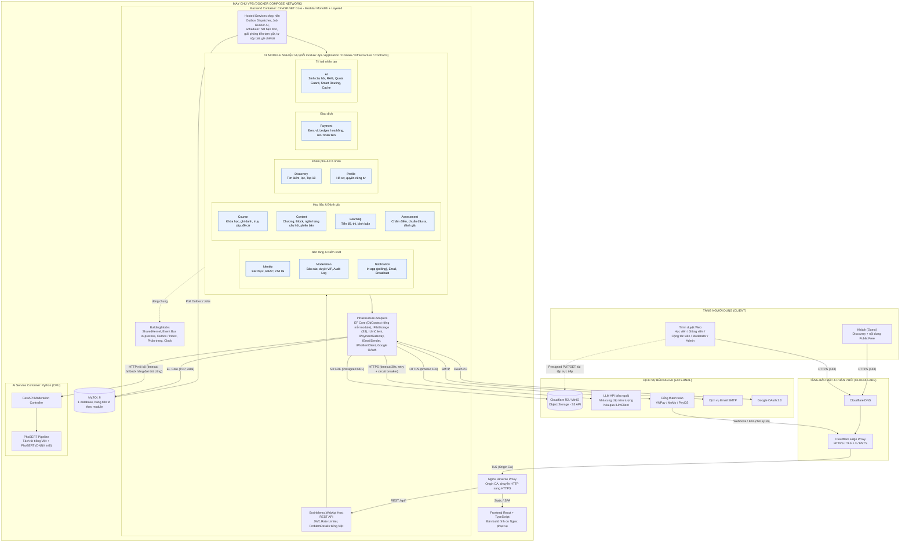
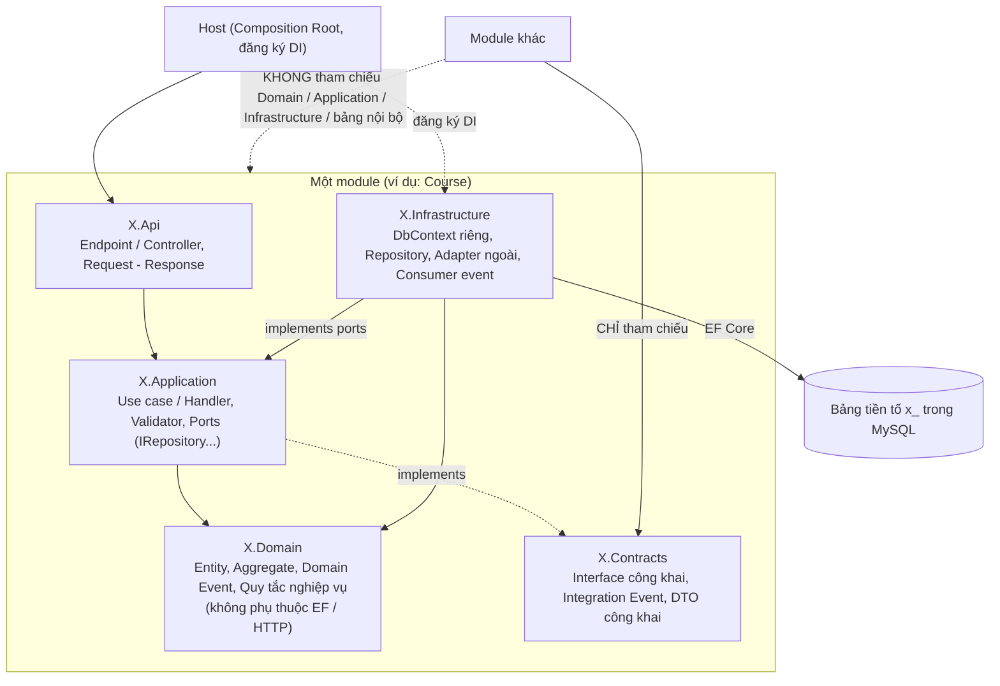
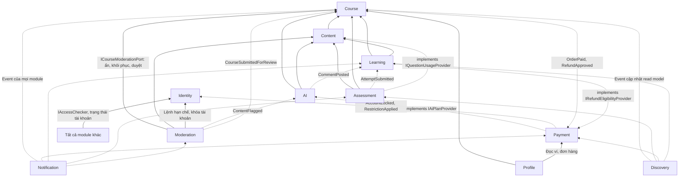
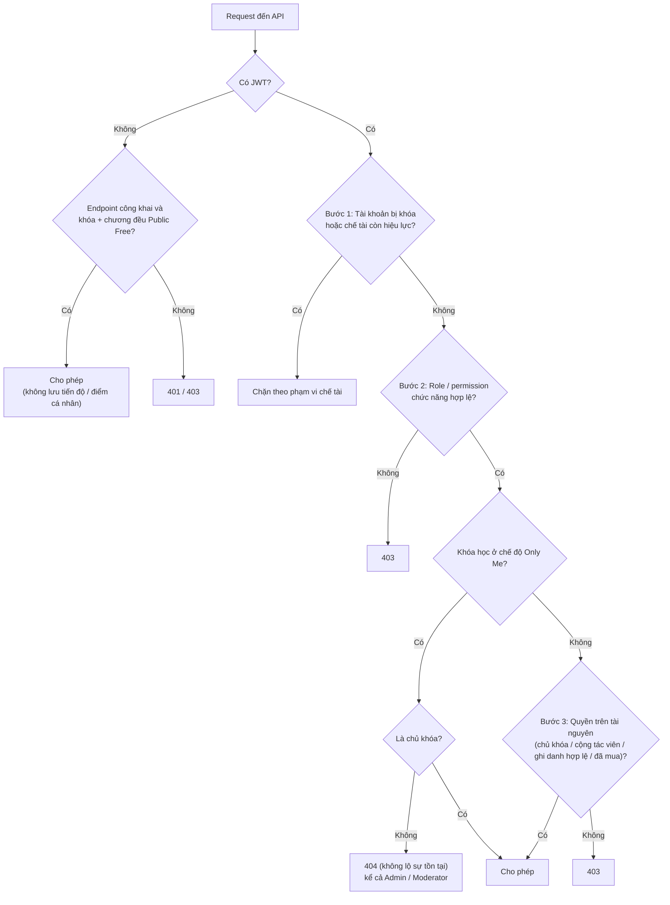
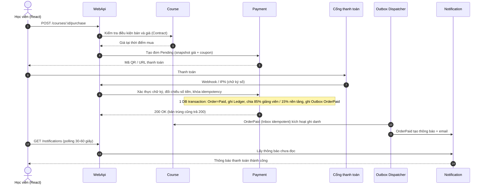
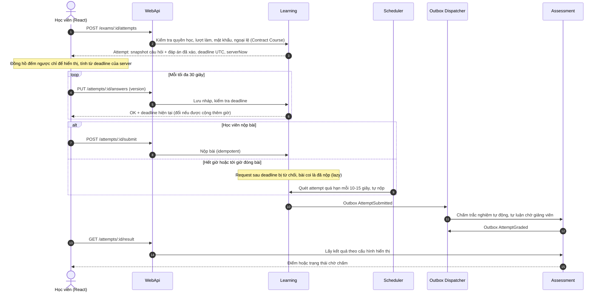
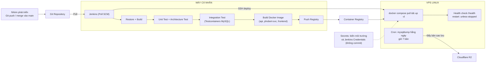

## 1. SƠ ĐỒ KIẾN TRÚC TỔNG THỂ

## 2. KIẾN TRÚC PHÂN TẦNG BÊN TRONG MỘT MODULE (LAYERED)

## 3. QUAN HỆ PHỤ THUỘC VÀ GIAO TIẾP GIỮA CÁC MODULE

Quy ước: `A → B` nghĩa là A chỉ tham chiếu `B.Contracts`. Nét liền: gọi Contract đồng bộ. Nét đứt: nhận event hoặc implement port do B định nghĩa (Dependency Inversion). Project `*.Contracts` không tham chiếu module nào nên không có vòng phụ thuộc.

## 4. LUỒNG KIỂM TRA QUYỀN TRUY CẬP

## 5. Sơ đồ tuần tự
### 5.1. LUỒNG MUA KHÓA HỌC (THANH TOÁN, OUTBOX, GHI DANH)

### 5.2. LUỒNG LÀM BÀI KIỂM TRA (REST + GIỜ SERVER)

## 6. SƠ ĐỒ TRIỂN KHAI VÀ CI/CD

